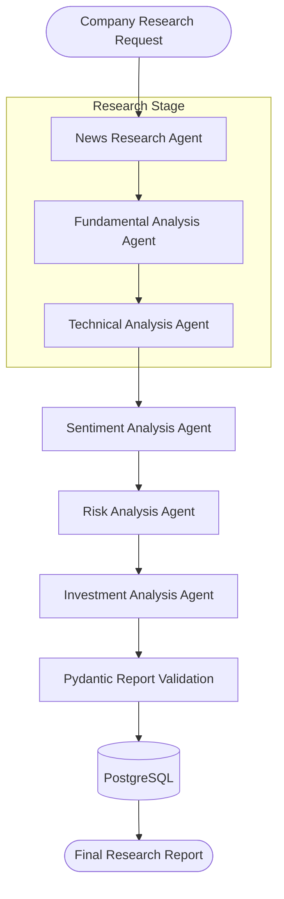
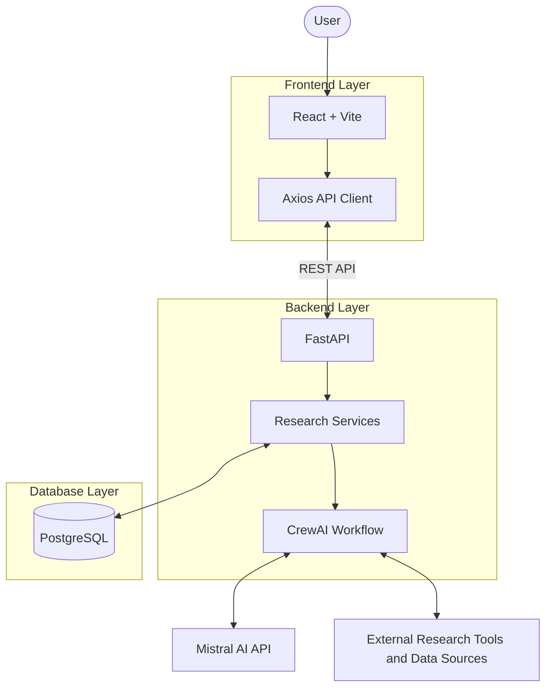

# FinCrew AI — Multi-Agent Financial Research Platform

**An AI-powered financial research and stock analysis platform built with CrewAI, Mistral AI, FastAPI, React, and PostgreSQL.**

FinCrew AI is a multi-agent financial research platform designed to analyze companies from multiple perspectives. It coordinates six specialized AI agents to investigate company news, financial fundamentals, technical indicators, market sentiment, and investment risks.

The findings are consolidated into a structured investment research report and presented through an interactive web dashboard.

## Overview

Traditional financial research involves collecting information from multiple sources and evaluating several dimensions of a company. FinCrew AI aims to organize this process using specialized AI agents working together through a coordinated research workflow.

### Key Features

- **Multi-Agent Research:** Six specialized CrewAI agents perform different research tasks.
- **News Research:** Investigates company-related news and market developments.
- **Fundamental Analysis:** Evaluates company financial performance and business fundamentals.
- **Technical Analysis:** Examines stock price trends and technical indicators.
- **Sentiment Analysis:** Evaluates market sentiment using research findings.
- **Risk Analysis:** Identifies potential financial and market-related risks.
- **Investment Analysis:** Consolidates specialist findings into a final research report.
- **Research History:** Stores and retrieves previous research jobs.
- **Interactive Dashboard:** Provides research submission, status tracking, and report visualization.
- **Report Export:** Allows users to export generated research reports.

## AI Agent Architecture

FinCrew AI uses six specialized agents:

| Agent | Responsibility |
|---|---|
| News Research Agent | Collects relevant company news and market developments. |
| Fundamental Analysis Agent | Evaluates financial performance and business fundamentals. |
| Technical Analysis Agent | Analyzes stock price trends and technical indicators. |
| Sentiment Analysis Agent | Evaluates sentiment based on research findings. |
| Risk Analysis Agent | Identifies investment risks and potential downside factors. |
| Investment Analysis Agent | Consolidates findings into the final investment research report. |

### Agent Workflow



## System Architecture

The platform follows a modular client-server architecture.



For detailed system design and component interactions, see [Architecture Documentation](docs/architecture.md).

## Technology Stack

| Category | Technology |
|---|---|
| Frontend | React.js, Vite |
| Styling | CSS, Tailwind CSS |
| Backend | Python, FastAPI |
| AI Agent Framework | CrewAI |
| Language Model | Mistral AI |
| Data Validation | Pydantic |
| Database | PostgreSQL |
| ORM | SQLAlchemy |
| HTTP Client | Axios |
| Package Management | uv, npm |
| Containerization | Docker, Docker Compose |

## Project Structure

```text
FinCrewAI/
│
├── backend/
│   ├── app/
│   │   ├── agents/
│   │   ├── api/
│   │   ├── crews/
│   │   ├── database/
│   │   ├── schemas/
│   │   ├── services/
│   │   ├── tasks/
│   │   ├── tools/
│   │   ├── utils/
│   │   ├── __init__.py
│   │   ├── config.py
│   │   └── main.py
│   │
│   ├──.dockerignore
│   ├──.env
│   ├── dockerfile
│   ├── pyproject.toml
│   ├── requirements.txt
│   └── uv.lock
│
├── docs/
│   ├── api_documentation.md
│   └── architecture.md
│
├── frontend/
│   ├── src/
│   │   ├── components/
│   │   ├── pages/
│   │   ├── services/
│   │   ├── utils/
│   │   ├── App.jsx
│   │   ├── main.jsx
│   │   └── styles.css
│   │
│   ├──.dockerignore
│   ├──.env
│   ├── dockerfile
│   ├── index.html
│   ├── package.json
│   ├── package-lock.json
│   └── vite.config.js
│
├── reports/
├── .gitignore
├── docker-compose.yml
└── README.md
```

### Backend Directory Responsibilities

| Directory | Responsibility |
|---|---|
| `agents/` | Defines the specialized AI agents. |
| `api/` | Contains FastAPI routes and endpoints. |
| `crews/` | Coordinates the CrewAI workflow. |
| `database/` | Handles PostgreSQL connections and database operations. |
| `schemas/` | Defines Pydantic models and validation schemas. |
| `services/` | Implements application and research business logic. |
| `tasks/` | Defines the tasks assigned to agents. |
| `tools/` | Contains research tools and external integrations. |
| `utils/` | Contains shared utilities and helper functions. |

## Getting Started

### Prerequisites

Install the following:

- Python 3.12
- Node.js and npm
- PostgreSQL
- uv package manager
- Docker Desktop (optional)
- Mistral AI API key
- API credentials for external research tools configured in the backend

### 1. Clone the Repository

```bash
git clone https://github.com/YOUR_USERNAME/FinCrewAI.git
cd FinCrewAI
```

Replace `YOUR_USERNAME` with your GitHub username and use your actual repository URL.

### 2. Backend Setup

Navigate to the backend:

```powershell
cd backend
```

Create the virtual environment:

```powershell
uv venv --python 3.12
```

Install dependencies:

```powershell
uv pip install --python .\.venv\Scripts\python.exe -r requirements.txt
```

Configure the backend environment variables using the variables required by `backend/app/config.py` and your database configuration.

Example:

```env
MISTRAL_API_KEY=your_mistral_api_key
TAVILY_API_KEY=your_tavily_api_key
```

Do not commit real API keys or credentials.

Start the backend:

```powershell
uvicorn app.main:app --reload
```

Backend URL:

`http://127.0.0.1:8000`

Swagger API documentation:

`http://127.0.0.1:8000/docs`

### 3. Frontend Setup

Open another terminal:

```powershell
cd frontend
```

Install dependencies:

```powershell
npm install
```

Configure `frontend/.env`:

```env
VITE_API_BASE_URL=http://127.0.0.1:8000
```

Start the frontend:

```powershell
npm run dev
```

Frontend URL:

`http://localhost:5173`

### 4. Database Configuration

FinCrew AI uses PostgreSQL for persistent research-job storage.

Before running the application:

1. Start your PostgreSQL server.
2. Configure the database connection using the environment variable expected by your backend.
3. Ensure the required database and tables are initialized.
4. Verify the connection before submitting research requests.

### 5. Docker Setup

From the project root, run:

```powershell
docker compose up --build
```

To run containers in the background:

```powershell
docker compose up --build -d
```

To stop the application:

```powershell
docker compose down
```

Check `docker-compose.yml` for the actual service names, ports, database configuration, and environment variables.

## API Documentation

The frontend communicates with the FastAPI backend through REST APIs.

| Method | Endpoint | Description |
|---|---|---|
| POST | `/api/v1/research` | Submit company research |
| GET | `/api/v1/research/history` | Retrieve research history |
| GET | `/api/v1/research/{research_id}` | Retrieve research status |
| GET | `/api/v1/research/{research_id}/report` | Retrieve the final report |

For detailed request formats, response examples, and error handling, see [API Documentation](docs/api_documentation.md).

## Documentation

| Document | Description |
|---|---|
| [Architecture Documentation](docs/architecture.md) | System architecture, agent workflow, database design, and deployment |
| [API Documentation](docs/api_documentation.md) | API endpoints, HTTP methods, request and response formats, and errors |

## Final Research Report

The consolidated investment research report is designed to include:

- Executive summary
- Overall investment outlook
- Confidence and risk assessment
- Positive and negative factors
- Short-, medium-, and long-term outlook
- Monitoring points
- Research limitations
- Final investment analysis

## Security Considerations

- Store API keys and credentials in environment variables.
- Never commit `.env` files containing secrets.
- Exclude virtual environments, `node_modules`, caches, and generated files using `.gitignore`.
- Validate incoming API requests and AI-generated reports.
- Verify financial claims against reliable sources before relying on them.

## Future Improvements

Potential enhancements include:

- Real-time research progress updates.
- Background execution for long-running research jobs.
- Source citations and automated fact verification.
- Agent execution monitoring and evaluation.
- User authentication and personalized research history.
- Financial data caching and performance optimization.
- Automated testing and CI/CD deployment.

## Disclaimer

FinCrew AI is an experimental AI-powered financial research platform. Its generated outputs may contain inaccuracies, incomplete information, or outdated financial data.

This application is intended for educational and research purposes only. It does not provide personalized financial advice or guarantee investment performance. Always conduct independent research before making investment decisions.

---

**Built with React, FastAPI, CrewAI, Mistral AI, and PostgreSQL.**