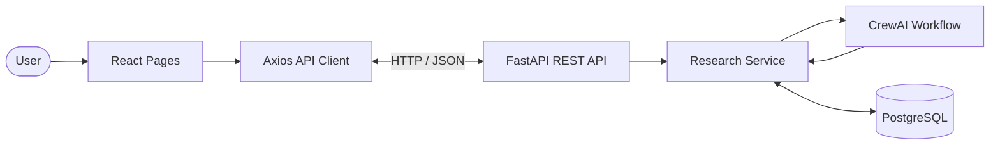

# FinCrew AI — API Documentation

## 1. Overview

This document describes the REST API used by the FinCrew AI frontend to communicate with its FastAPI backend.

The API supports:

- Submitting company research requests.
- Retrieving research-job status.
- Viewing research history.
- Retrieving consolidated investment research reports.
- Retrieving historical stock data, if the corresponding backend endpoint is implemented.

### API Configuration

| Property | Value |
|---|---|
| Backend Framework | FastAPI |
| API Style | REST |
| Data Format | JSON |
| HTTP Client | Axios |
| Local Base URL | `http://127.0.0.1:8000` |
| API Prefix | `/api/v1` |

### Interactive API Documentation

FastAPI automatically provides interactive API documentation.

| Documentation | URL |
|---|---|
| Swagger UI | `http://127.0.0.1:8000/docs` |
| ReDoc | `http://127.0.0.1:8000/redoc` |

Swagger UI is the primary reference for verifying the actual request and response schemas implemented by the backend.

## 2. API Architecture

The frontend uses Axios to send HTTP requests to the FastAPI backend.



### Communication Flow

1. The user interacts with a React page.
2. The frontend calls a function from `services/api.js`.
3. Axios sends the HTTP request to FastAPI.
4. FastAPI processes the request and invokes the appropriate service.
5. The backend returns a JSON response.
6. React updates the interface using the returned data.

## 3. API Endpoint Summary

The frontend API client currently defines the following endpoints.

| No. | Method | Endpoint | Purpose |
|---|---|---|---|
| 1 | `POST` | `/api/v1/research` | Submit new company research |
| 2 | `GET` | `/api/v1/research/history` | Retrieve research history |
| 3 | `GET` | `/api/v1/research/{research_id}` | Retrieve research status |
| 4 | `GET` | `/api/v1/research/{research_id}/report` | Retrieve final research report |
| 5 | `GET` | `/api/v1/stocks/{ticker}/history` | Retrieve historical stock data, if implemented |

**Note:** These paths are taken from the frontend API client. Confirm that every route is registered in the running FastAPI backend before treating it as an implemented endpoint.

## 4. Submit Company Research

### Endpoint

`POST /api/v1/research`

### Description

Creates a new company research job. The user provides a company name and may optionally provide a stock ticker.

### Request Headers

```http
Content-Type: application/json
```

### Request Body

**Example with ticker:**

```json
{
  "company": "Tata Steel",
  "ticker": "TATASTEEL.NS"
}
```

**Example without ticker:**

```json
{
  "company": "Tata Steel"
}
```

### Request Parameters

| Field | Type | Required | Description |
|---|---|---|---|
| `company` | String | Yes | Name of the company |
| `ticker` | String | No | Stock ticker symbol |

### Successful Response

Illustrative response:

```json
{
  "research_id": "research-12345",
  "company": "Tata Steel",
  "ticker": "TATASTEEL.NS",
  "status": "pending"
}
```

The frontend accepts the research identifier from `research_id`, `id`, or `job_id`.

### Example cURL Request

```bash
curl -X POST "http://127.0.0.1:8000/api/v1/research" \
  -H "Content-Type: application/json" \
  -d '{
    "company": "Tata Steel",
    "ticker": "TATASTEEL.NS"
  }'
```

### Frontend Integration

The frontend calls:

```javascript
submitResearch(company, ticker);
```

The function is defined in:

`frontend/src/services/api.js`

## 5. Retrieve Research Status

### Endpoint

`GET /api/v1/research/{research_id}`

### Description

Retrieves the current status and details of a specific research job.

### Path Parameters

| Parameter | Type | Description |
|---|---|---|
| `research_id` | String | Unique identifier of the research job |

### Example Request

```http
GET /api/v1/research/research-12345
```

### Illustrative Response

```json
{
  "research_id": "research-12345",
  "company": "Tata Steel",
  "ticker": "TATASTEEL.NS",
  "status": "processing",
  "created_at": "2026-11-07T10:00:00",
  "updated_at": "2026-11-07T10:02:00"
}
```

### Research Status Values

| Status | Description |
|---|---|
| `pending` | Research request has been accepted |
| `processing` | CrewAI research workflow is executing |
| `completed` | Research report has been generated and saved |
| `failed` | Research execution or report processing failed |

### Frontend Integration

```javascript
getResearchStatus(researchId);
```

The frontend uses this function to display the current research-job status.

## 6. Retrieve Research History

### Endpoint

`GET /api/v1/research/history`

### Description

Retrieves previously submitted research jobs stored by the backend.

### Example Request

```http
GET /api/v1/research/history
```

### Illustrative Response

```json
[
  {
    "research_id": "research-12345",
    "company": "Tata Steel",
    "ticker": "TATASTEEL.NS",
    "status": "completed",
    "created_at": "2026-11-07T10:00:00",
    "updated_at": "2026-11-07T10:05:00"
  },
  {
    "research_id": "research-12346",
    "company": "Apple",
    "ticker": "AAPL",
    "status": "processing",
    "created_at": "2026-11-07T11:00:00",
    "updated_at": "2026-11-07T11:02:00"
  }
]
```

### Frontend Integration

```javascript
getResearchHistory();
```

The frontend supports a direct array response or common wrapped list properties:

- `items`
- `results`
- `research_jobs`
- `history`

## 7. Retrieve Final Research Report

### Endpoint

`GET /api/v1/research/{research_id}/report`

### Description

Retrieves the consolidated investment research report generated by the six-agent CrewAI workflow.

### Path Parameters

| Parameter | Type | Description |
|---|---|---|
| `research_id` | String | Unique identifier of the research job |

### Example Request

```http
GET /api/v1/research/research-12345/report
```

### Illustrative Response

The exact response structure depends on the backend implementation.

Example using a JSON-string report:

```json
{
  "research_id": "research-12345",
  "company": "Tata Steel",
  "ticker": "TATASTEEL.NS",
  "status": "completed",
  "final_report": "{ ... validated report JSON ... }"
}
```

The report may contain information such as:

- Executive summary
- Investment outlook
- Confidence assessment
- Risk assessment
- Positive factors
- Negative factors
- Time-horizon analysis
- Sentiment analysis
- Risk analysis
- Monitoring points
- Research limitations
- Final conclusion

### Frontend Integration

```javascript
getResearchReport(researchId);
```

The frontend passes the report content to:

```jsx
<ReportContent content={content} />
```

The report component is responsible for parsing and displaying the report.

## 8. Retrieve Stock Price History

### Endpoint

`GET /api/v1/stocks/{ticker}/history`

### Description

The frontend API client includes a function for requesting historical stock-price data.

**Important:** The frontend definition alone does not confirm that this endpoint is implemented in FastAPI. Verify its availability in Swagger before using it.

### Path Parameters

| Parameter | Type | Description |
|---|---|---|
| `ticker` | String | Stock ticker symbol |

### Query Parameters

| Parameter | Type | Default | Description |
|---|---|---|---|
| `period` | String | `1y` | Requested historical data period |

### Example Request

```http
GET /api/v1/stocks/TATASTEEL.NS/history?period=1y
```

### Frontend Integration

```javascript
getStockHistory("TATASTEEL.NS", "1y");
```

The frontend supports common response shapes containing:

- An array of records.
- A `history` property.
- A `prices` property.
- A `data` property.

The exact response schema must be confirmed from the backend route.

## 9. Error Handling

The frontend uses a centralized error-handling function:

```javascript
getApiError(error);
```

It attempts to retrieve the error detail from the FastAPI response.

### Example Error Response

```json
{
  "detail": "Research job not found"
}
```

### Common HTTP Status Codes

| Status Code | Name | Description |
|---|---|---|
| `200` | OK | Request completed successfully |
| `201` | Created | Resource successfully created, if returned by the backend |
| `400` | Bad Request | Invalid request |
| `404` | Not Found | Requested research job or resource does not exist |
| `422` | Unprocessable Entity | Request validation failed |
| `500` | Internal Server Error | Unexpected backend error |

These are common HTTP status-code conventions. Actual status codes depend on the FastAPI route implementations.

### Frontend Error Handling

The API error handler checks:

1. Whether the response contains a FastAPI `detail` field.
2. Whether the backend is reachable.
3. Whether the request failed for another reason.

If the backend is unreachable, the frontend displays a connection error asking the user to verify the backend service and API base URL.

## 10. Frontend API Configuration

The frontend centralizes API configuration in:

`frontend/src/services/api.js`

### Base URL

The API base URL is configured using the Vite environment variable:

```env
VITE_API_BASE_URL=http://127.0.0.1:8000
```

### Axios Configuration

The Axios client is configured with:

- Base URL from `VITE_API_BASE_URL`.
- A 30-second request timeout.
- JSON content-type headers.

### Centralized API Paths

The frontend defines its route paths in the `API_PATHS` object.

This keeps endpoint definitions in one location and makes API maintenance easier.

## 11. CORS Configuration

The FastAPI backend must allow requests from the frontend development server.

The currently configured development origins are:

```python
allow_origins=[
    "http://localhost:5173",
    "http://127.0.0.1:5173"
]
```

The backend also allows configured HTTP methods and headers.

For production deployment, configure CORS to allow only the actual frontend origins required by the application.

## 12. API Testing

Use FastAPI Swagger UI to test API endpoints.

### Testing Procedure

1. Start the FastAPI backend.
2. Open `http://127.0.0.1:8000/docs`.
3. Select the endpoint.
4. Click **Try it out**.
5. Enter the required request data.
6. Execute the request.
7. Inspect the response body and HTTP status code.

### Suggested Test Cases

| Test | Expected Behavior |
|---|---|
| Submit a valid company name | Research job is created |
| Submit without a ticker | Research request is accepted if ticker is optional |
| Retrieve an existing research ID | Job details are returned |
| Retrieve an unknown research ID | Appropriate not-found response |
| Retrieve research history | Saved research jobs are returned |
| Retrieve a completed report | Consolidated report is returned |
| Submit an empty company name | Request is rejected by validation |
| Call API while backend is stopped | Frontend displays connection error |

Expected behavior should be verified against the actual backend implementation.

## 13. Security Considerations

- Never expose API keys in frontend source code.
- Keep Mistral and external research API credentials in backend environment variables.
- Do not commit secret-containing `.env` files.
- Validate incoming request data.
- Restrict CORS origins in production.
- Avoid exposing internal exception details to public API clients.
- Use authentication and authorization before exposing private research data in a multi-user production deployment.

## 14. Related Documentation

| Document | Description |
|---|---|
| [Project README](../README.md) | Project overview, features, installation, and usage |
| [System Architecture](./architecture.md) | Application components, AI agent workflow, database, and deployment |

---

**FinCrew AI — Multi-Agent Financial Research Platform.**
