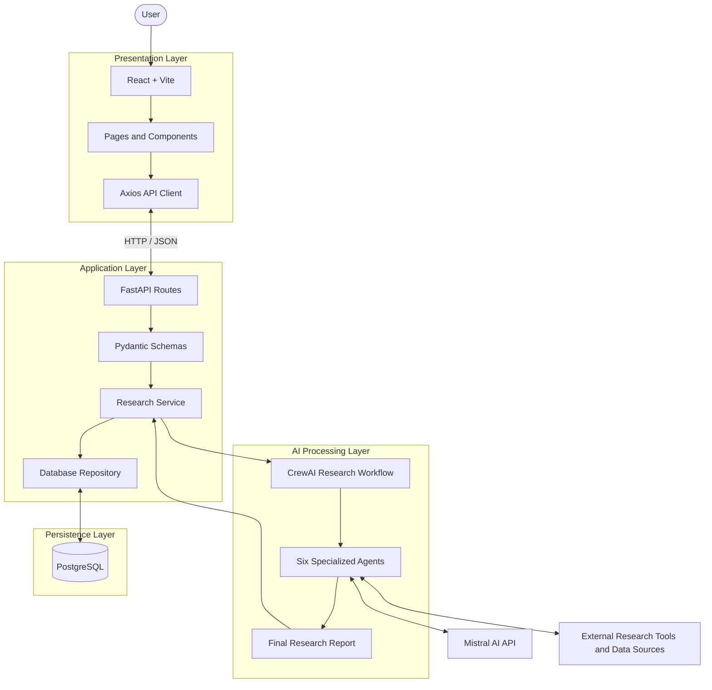
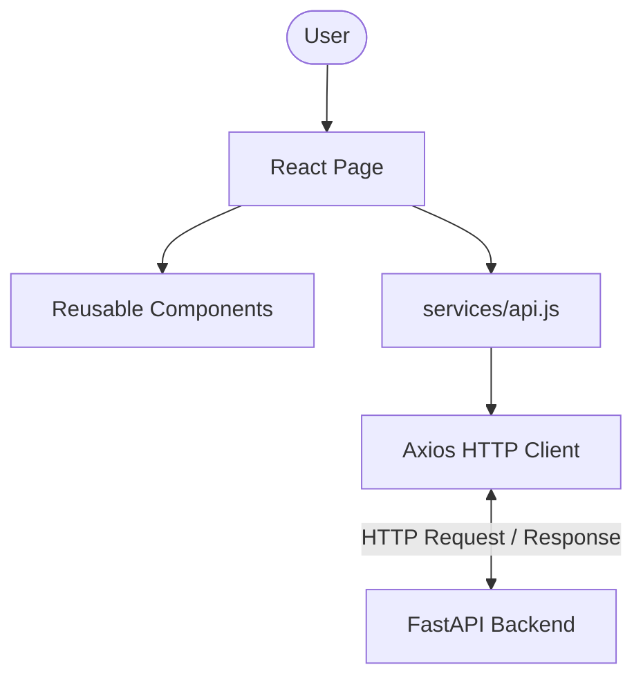
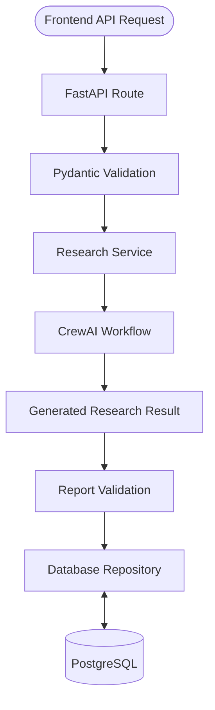
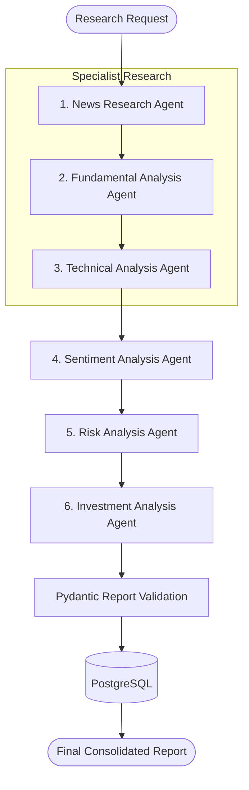
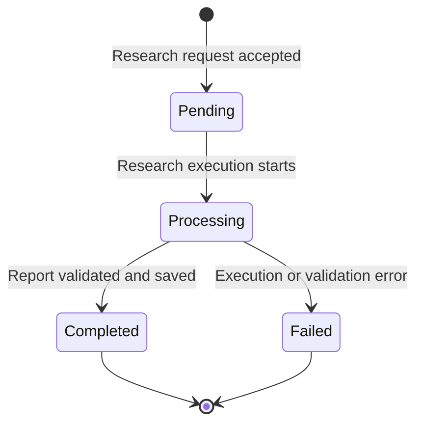
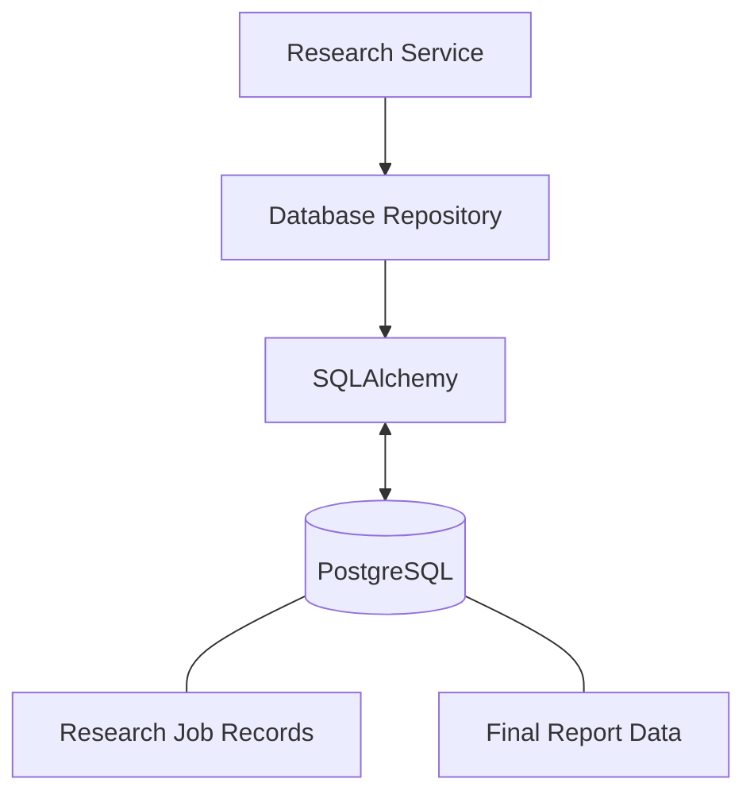
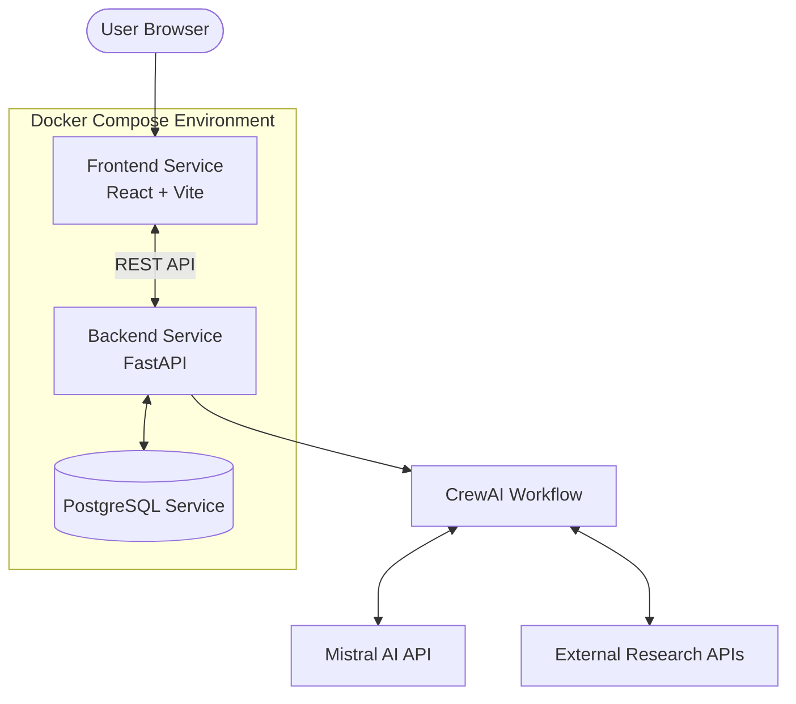

# FinCrew AI — System Architecture

## 1. Introduction

FinCrew AI is a multi-agent financial research and stock analysis platform built using React, FastAPI, CrewAI, Mistral AI, and PostgreSQL.

The application accepts a company name and an optional stock ticker from the user. The backend coordinates six specialized AI agents to investigate different dimensions of the company and produces a consolidated investment research report.

The architecture follows a modular design that separates:

- Frontend presentation
- Backend API and business logic
- AI agent orchestration
- Database and persistence

## 2. Architecture Overview

The application is organized into four major layers.

| Layer | Technology | Responsibility |
|---|---|---|
| Presentation Layer | React, Vite | User interaction and report visualization |
| Application Layer | FastAPI, Python | API handling, validation, and research services |
| AI Processing Layer | CrewAI, Mistral AI | Multi-agent research and report generation |
| Persistence Layer | PostgreSQL, SQLAlchemy | Research-job and report storage |

### High-Level Architecture Diagram



### Component Responsibilities

| Component | Responsibility |
|---|---|
| React frontend | Provides the user interface |
| Axios | Sends HTTP requests to FastAPI |
| FastAPI | Exposes REST API endpoints |
| Pydantic | Validates input and report structures |
| Research Service | Coordinates research-job execution |
| CrewAI | Orchestrates the specialized agents |
| Mistral AI | Provides language-model capabilities |
| SQLAlchemy | Handles database interactions |
| PostgreSQL | Persists research jobs and reports |

## 3. Project Directory Architecture

The project follows a modular directory structure.

```text
FinCrewAI/
│
├── backend/
│   ├── app/
│   │   ├── agents/
│   │   ├── api/
│   │   ├── crews/
│   │   ├── database/
│   │   ├── schemas/
│   │   ├── services/
│   │   ├── tasks/
│   │   ├── tools/
│   │   ├── utils/
│   │   ├── __init__.py
│   │   ├── config.py
│   │   └── main.py
│   │
│   ├──.dockerignore
│   ├──.env
│   ├── dockerfile
│   ├── pyproject.toml
│   ├── requirements.txt
│   └── uv.lock
│
├── docs/
│   ├── api_documentation.md
│   └── architecture.md
│
├── frontend/
│   ├── src/
│   │   ├── components/
│   │   ├── pages/
│   │   ├── services/
│   │   ├── utils/
│   │   ├── App.jsx
│   │   ├── main.jsx
│   │   └── styles.css
│   │
│   ├──.dockerignore
│   ├──.env
│   ├── dockerfile
│   ├── index.html
│   ├── package.json
│   ├── package-lock.json
│   └── vite.config.js
│
├── reports/
├── .gitignore
├── docker-compose.yml
└── README.md
```

### Backend Module Responsibilities

| Directory / File | Responsibility |
|---|---|
| `agents/` | Defines the six specialized AI agents |
| `api/` | Contains FastAPI routes and endpoint definitions |
| `crews/` | Coordinates the CrewAI research workflow |
| `database/` | Handles database connections and persistence operations |
| `schemas/` | Defines Pydantic models and data validation |
| `services/` | Implements research business logic |
| `tasks/` | Defines the tasks assigned to AI agents |
| `tools/` | Contains research tools and external integrations |
| `utils/` | Contains reusable helper functions |
| `config.py` | Loads application configuration and AI model settings |
| `main.py` | Initializes the FastAPI application |

### Frontend Module Responsibilities

| Directory / File | Responsibility |
|---|---|
| `components/` | Reusable UI components |
| `pages/` | Main application pages |
| `services/` | API communication through Axios |
| `utils/` | Formatting and shared helper functions |
| `App.jsx` | Main application component and routing |
| `main.jsx` | React application entry point |
| `styles.css` | Application styling |

## 4. Frontend Architecture

The frontend is developed using React and Vite.

It provides the interface through which users submit research requests, browse research history, and view consolidated investment reports.

### Main Pages

| Page | Responsibility |
|---|---|
| New Research | Accepts a company name and optional ticker |
| Research History | Displays saved research jobs with search and status filters |
| Research Report | Displays job status and the final research report |
| Settings | Displays backend connection information |

### Frontend Request Flow



The API base URL is configurable using:

```env
VITE_API_BASE_URL=http://127.0.0.1:8000
```

The frontend centralizes endpoint paths and HTTP operations in `frontend/src/services/api.js`.

## 5. Backend Architecture

The backend is developed using Python and FastAPI.

It handles incoming requests, validates input data, starts the research workflow, and stores the generated reports.

### Backend Request Flow



### Backend Responsibilities

1. Accept requests from the frontend.
2. Validate company and ticker information.
3. Create and manage research jobs.
4. Execute the CrewAI workflow.
5. Validate the final generated report.
6. Persist the report and job status.
7. Provide status, history, and report endpoints.

## 6. Multi-Agent Architecture

The central part of FinCrew AI is its six-agent research workflow.

Each agent has a specialized responsibility. This separation allows the research process to cover different aspects of a company's financial and market position.

### Agent Responsibilities

| No. | Agent | Responsibility | Expected Contribution |
|---|---|---|---|
| 1 | News Research Agent | Researches company news and market developments | News and event findings |
| 2 | Fundamental Analysis Agent | Examines financial performance and business fundamentals | Fundamental assessment |
| 3 | Technical Analysis Agent | Examines price trends and technical indicators | Technical assessment |
| 4 | Sentiment Analysis Agent | Evaluates sentiment using previous research findings | Sentiment assessment |
| 5 | Risk Analysis Agent | Identifies investment risks and downside factors | Risk assessment |
| 6 | Investment Analysis Agent | Consolidates the specialist findings | Final investment report |

### Agent Execution Workflow

The current workflow is designed around sequential task dependencies.



### Agent Information Flow

**Stage 1 — Specialist Research**

- News Research Agent gathers relevant company and market developments.
- Fundamental Analysis Agent evaluates the company's financial position.
- Technical Analysis Agent examines stock price behavior and technical signals.

**Stage 2 — Sentiment Evaluation**

The Sentiment Analysis Agent uses the earlier research findings to evaluate the overall sentiment surrounding the company.

**Stage 3 — Risk Assessment**

The Risk Analysis Agent evaluates potential risks using the available research and sentiment findings.

**Stage 4 — Investment Consolidation**

The Investment Analysis Agent combines the specialist findings into one consolidated investment research report.

**Stage 5 — Report Validation**

The backend validates the generated output using the Pydantic report schema before saving it.

## 7. Research Job Lifecycle

Each research request follows a defined lifecycle.

### Job State Diagram



### Lifecycle Explanation

| Status | Description |
|---|---|
| `pending` | Research job has been accepted |
| `processing` | AI research workflow is executing |
| `completed` | Final report has been generated, validated, and saved |
| `failed` | Research execution or report processing failed |

### End-to-End Research Sequence

1. User submits a company name and optional ticker.
2. Frontend sends a request to FastAPI.
3. Backend validates the request.
4. A research job is created in the database.
5. CrewAI executes the six-agent workflow.
6. The final agent generates the consolidated report.
7. Pydantic validates the report structure.
8. The backend stores the report and updates the job status.
9. The frontend retrieves the completed report.

## 8. Database Architecture

FinCrew AI uses PostgreSQL for persistent storage and SQLAlchemy for database operations.

### Research Job Data Model

The research-job record includes the following fields:

| Field | Description |
|---|---|
| `research_id` | Unique identifier for a research job |
| `company` | Company name being analyzed |
| `ticker` | Optional stock ticker |
| `status` | Current research-job status |
| `final_report` | Stored consolidated report |
| `error` | Error details when a job fails |
| `created_at` | Job creation timestamp |
| `updated_at` | Last update timestamp |

### Database Interaction



The exact column types, constraints, indexes, and relationships are defined in the backend database models.

## 9. API Architecture

The frontend communicates with the backend using REST APIs.

### Main API Endpoints

| Method | Endpoint | Purpose |
|---|---|---|
| `POST` | `/api/v1/research` | Submit a research request |
| `GET` | `/api/v1/research/history` | Retrieve research history |
| `GET` | `/api/v1/research/{research_id}` | Retrieve research status |
| `GET` | `/api/v1/research/{research_id}/report` | Retrieve the final report |

The frontend API client also includes a stock-history endpoint:

`GET /api/v1/stocks/{ticker}/history`

Its availability depends on the corresponding backend route being implemented.

For request and response formats, error handling, and API configuration, refer to [API Documentation](./api_documentation.md).

## 10. External Integrations

FinCrew AI uses external services to support its AI research workflow.

| Integration | Purpose |
|---|---|
| Mistral AI | Language-model inference for the agents |
| Tavily | Web research, where configured in the research tools |
| Other research tools | Additional information gathering according to the configured agent tools |

API credentials are configured through environment variables and should never be committed to version control.

External data availability, API limits, and source quality can affect research results.

## 11. Deployment Architecture

The project includes Dockerfiles and a Docker Compose configuration to support containerized execution.

### Deployment Diagram



### Deployment Responsibilities

| Component | Responsibility |
|---|---|
| Frontend container | Serves the React application |
| Backend container | Runs FastAPI and research services |
| PostgreSQL container | Stores research jobs and reports |
| Mistral AI API | Provides model inference |
| External research APIs | Provide information for agent research |

The exact container names, ports, volumes, and environment settings should be verified against `docker-compose.yml`.

## 12. Configuration and Environment Variables

Environment variables are used to configure application services and credentials.

Examples used by the backend include:

```env
MISTRAL_API_KEY=your_mistral_api_key
TAVILY_API_KEY=your_tavily_api_key
```

The frontend uses:

```env
VITE_API_BASE_URL=http://127.0.0.1:8000
```

Other variables, particularly the PostgreSQL connection string, must match the names expected by the actual backend configuration.

Never expose secret values in source code or public repositories.

## 13. Design Principles

### Modularity

Each major responsibility is separated into its own backend or frontend module.

### Separation of Concerns

The frontend handles presentation, FastAPI handles application requests, CrewAI handles agent orchestration, and PostgreSQL handles persistence.

### Structured Validation

Pydantic validates user input and the final AI-generated report.

### Maintainability

Agents, tasks, tools, services, schemas, and database logic are organized separately.

### Traceability

Research jobs maintain status and error information, allowing users to inspect previous research activity.

## 14. Limitations and Future Improvements

Potential improvements include:

- Background execution for long-running research jobs.
- Real-time progress updates.
- Stronger financial fact verification and source citations.
- Agent execution tracing and evaluation.
- User authentication and access control.
- Financial data caching.
- Automated testing and CI/CD deployment.
- More detailed database relationships and research metadata.

These are potential enhancements, not claims that every feature is currently implemented.

## 15. Related Documentation

| Document | Description |
|---|---|
| [README](../README.md) | Project introduction, features, installation, and usage |
| [API Documentation](./api_documentation.md) | API endpoints, request and response formats, and errors |

---

**FinCrew AI — Multi-Agent Financial Research and Analysis.**
